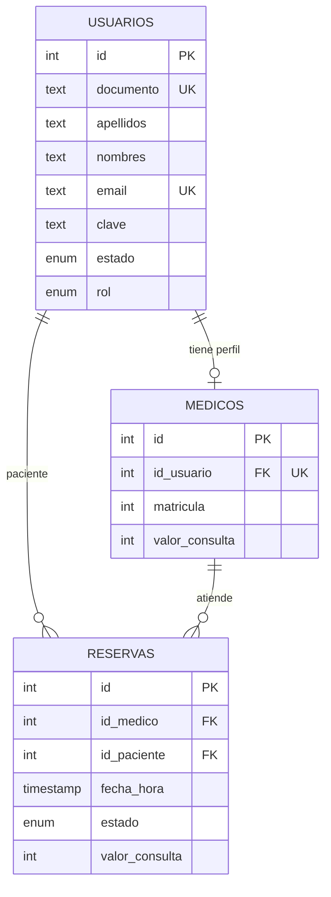

# Guía ordenada de despliegue e infraestructura

**TFI 2026 — Clínica Médica — Grupo AF**

Esta guía ordena los procesos de:

1. Base de datos PostgreSQL con Docker.
2. Backend NestJS.
3. Frontend Angular.
4. PM2.
5. Nginx.
6. Verificación.
7. Diseño relacional de la tabla `medicos`.
8. Documentación para la defensa.

> **Importante:** PM2 y Nginx se usan en el servidor Linux de producción. Para
> desarrollar en Windows alcanza con Docker + backend + `ng serve`.

---

## 0. Orden recomendado

```text
1. PostgreSQL en Docker
        ↓
2. Backend NestJS (TypeORM crea las tablas y el seeder carga los datos)
        ↓
3. Frontend Angular
        ↓
4. PM2 (mantiene vivo el backend en el servidor)
        ↓
5. Nginx (sirve Angular y redirige /api al backend)
        ↓
6. Verificación y evidencias
```

---

## 1. PostgreSQL con Docker

### 1.1 Glosario: Docker en inglés → español

| Inglés | Español | Qué significa |
| :--- | :--- | :--- |
| Image | Imagen | Plantilla para crear un contenedor. Ej.: `postgres:16`. |
| Container | Contenedor | Instancia en ejecución de una imagen. |
| Volume | Volumen | Espacio donde se guardan los datos aunque se reinicie el contenedor. |
| Ports | Puertos | Relación `puerto_de_tu_PC:puerto_del_contenedor`. |
| Environment variables | Variables de entorno | Configuración del contenedor, por ejemplo usuario y contraseña. |
| Logs | Registros | Mensajes de lo que está pasando dentro del contenedor. |
| Exec / Terminal | Terminal dentro del contenedor | Permite ejecutar comandos como `psql`. |
| Start / Stop / Restart | Iniciar / Detener / Reiniciar | Acciones sobre el contenedor. |
| Pull | Descargar | Bajar una imagen desde Docker Hub. |
| Run | Ejecutar | Crear y arrancar un contenedor. |
| Inspect | Inspeccionar | Ver la configuración completa del contenedor. |
| Compose | Orquestador | Archivo `.yml` que describe uno o varios contenedores. |

### 1.2 Opción recomendada: Docker Compose

Ya está creado el archivo:

```text
deploy/database/docker-compose.yml
```

Antes de arrancar, revisá si ya tenés otro PostgreSQL usando el puerto 5434:

```bash
docker ps
```

Si aparece un contenedor usando ese puerto, podés seguir usándolo y **no
ejecutes Compose al mismo tiempo**. Si querés migrar al contenedor nuevo,
primero detené y eliminá el viejo (sus datos se pierden si no tenía un volumen;
el seeder vuelve a crear los datos de prueba).

> **¿Por qué 5434?** El puerto estándar de PostgreSQL es 5432 y el 5433 suele
> quedar ocupado por otras instalaciones o por Docker Desktop. Usando 5434
> evitamos esos conflictos. Si en tu máquina también está ocupado, cambiá el
> puerto en `docker-compose.yml` y en `backend/.env`.

Desde la raíz del repositorio:

```bash
cd deploy/database
docker compose up -d
```

Verificar que quedó corriendo:

```bash
docker compose ps
```

Ver los registros:

```bash
docker compose logs -f postgres
```

Detener sin borrar datos:

```bash
docker compose down
```

Detener y borrar también los datos (¡cuidado!):

```bash
docker compose down -v
```

El contenedor se llama `clinica-postgres` y publica el puerto:

```text
5434 en tu PC  →  5432 dentro del contenedor
```

### 1.3 Opción alternativa: Docker Desktop con interfaz

Si preferís usar la interfaz gráfica:

1. Abrir **Docker Desktop** y esperar a que diga **Engine running**.
2. Ir a **Images**.
3. Buscar `postgres:16` y hacer clic en **Pull**.
4. Ir a **Containers** y crear un contenedor nuevo:
   - **Image:** `postgres:16`
   - **Container name:** `clinica-postgres`
   - **Host port:** `5434`
   - **Container port:** `5432`
   - **Environment variables:**
     - `POSTGRES_USER=postgres`
     - `POSTGRES_PASSWORD=postgres`
     - `POSTGRES_DB=clinica_medica`
   - **Volume:** crear `clinica_postgres_data` y montarlo en
     `/var/lib/postgresql/data`.
5. Hacer clic en **Run / Start**.
6. Verificar en **Logs** que aparezca `database system is ready to accept connections`.

> La interfaz de Docker Desktop cambia según la versión. Si no encontrás una
> opción, usá los comandos de la sección 1.2, que son más estables.

### 1.4 Verificar la conexión a PostgreSQL

```bash
docker exec -it clinica-postgres psql -U postgres -d clinica_medica -c "\dt"
```

Al principio puede decir `Did not find any relations`. Es normal: las tablas
las crea TypeORM cuando arranca el backend.

También podés entrar a la consola interactiva:

```bash
docker exec -it clinica-postgres psql -U postgres -d clinica_medica
```

Dentro de `psql`:

```sql
\dt
SELECT * FROM usuarios;
\q
```

### 1.5 Si el puerto 5434 ya está ocupado

Ver qué contenedor está usando el puerto:

```bash
docker ps
```

Si existe otro contenedor PostgreSQL, podés detenerlo:

```bash
docker stop NOMBRE_O_ID_DEL_CONTENEDOR
```

O cambiar el puerto en `docker-compose.yml` y en `backend/.env`.

---

## 2. Backend NestJS

### 2.1 Configurar variables de entorno

```bash
cd backend
cp .env.example .env
```

En Windows PowerShell:

```powershell
Copy-Item .env.example .env
```

Valores importantes para Docker:

```env
PORT=3000
DB_HOST=localhost
DB_PORT=5434
DB_USERNAME=postgres
DB_PASSWORD=postgres
DB_DATABASE=clinica_medica
JWT_SECRET=cambiar_esta_clave_en_produccion
SEED_DEFAULT_USERS=true
SEED_DEFAULT_PASSWORD=123456
```

### 2.2 Instalar dependencias y arrancar

```bash
npm install
npm run start:dev
```

Al iniciar:

1. TypeORM crea o actualiza las tablas (`synchronize: true`).
2. El seeder verifica y crea los usuarios, médicos y reservas de ejemplo.
3. La API queda disponible en `http://localhost:3000/api`.
4. Swagger queda disponible en `http://localhost:3000/api/docs`.

> **Si ya tenías la base creada antes de agregar `matricula`:** TypeORM no puede
> agregar una columna `NOT NULL` a una tabla con filas. Ejecutá una vez esta
> migración manual y después reiniciá el backend:
>
> ```bash
> docker exec -it clinica-postgres psql -U postgres -d clinica_medica -c \
> "ALTER TABLE medicos ADD COLUMN IF NOT EXISTS matricula INTEGER;
>  UPDATE medicos SET matricula = 1000 + id WHERE matricula IS NULL;
>  ALTER TABLE medicos ALTER COLUMN matricula SET NOT NULL;"
> ```
>
> En una base nueva no hace falta: TypeORM crea `matricula` directamente.

> **Si tu base se creó con una versión anterior y los ENUM tienen nombres
> automáticos** (`usuarios_estado_enum`, `usuarios_rol_enum`,
> `reservas_estado_enum`), renombralos una vez para que coincidan con la
> consigna. Este bloque es idempotente:
>
> ```bash
> docker exec -i clinica-postgres psql -U postgres -d clinica_medica <<'SQL'
> DO $do$
> BEGIN
>   IF EXISTS (SELECT 1 FROM pg_type WHERE typname = 'usuarios_estado_enum')
>      AND NOT EXISTS (SELECT 1 FROM pg_type WHERE typname = 'estados_usuarios') THEN
>     ALTER TYPE usuarios_estado_enum RENAME TO estados_usuarios;
>   END IF;
>
>   IF EXISTS (SELECT 1 FROM pg_type WHERE typname = 'usuarios_rol_enum')
>      AND NOT EXISTS (SELECT 1 FROM pg_type WHERE typname = 'roles_usuarios') THEN
>     ALTER TYPE usuarios_rol_enum RENAME TO roles_usuarios;
>   END IF;
>
>   IF EXISTS (SELECT 1 FROM pg_type WHERE typname = 'reservas_estado_enum')
>      AND NOT EXISTS (SELECT 1 FROM pg_type WHERE typname = 'estados_reservas') THEN
>     ALTER TYPE reservas_estado_enum RENAME TO estados_reservas;
>   END IF;
> END $do$;
> SQL
> ```

### 2.3 Verificar los datos cargados

```bash
docker exec -it clinica-postgres psql -U postgres -d clinica_medica -c \
"SELECT id, email, rol FROM usuarios ORDER BY id;"
```

```bash
docker exec -it clinica-postgres psql -U postgres -d clinica_medica -c \
"SELECT m.id, u.nombres, u.apellidos, m.matricula, m.valor_consulta
 FROM medicos m
 JOIN usuarios u ON u.id = m.id_usuario
 ORDER BY m.id;"
```

```bash
docker exec -it clinica-postgres psql -U postgres -d clinica_medica -c \
"SELECT id, id_medico, id_paciente, fecha_hora, estado, valor_consulta
 FROM reservas ORDER BY id;"
```

---

## 3. Frontend Angular

### 3.1 Desarrollo local

```bash
cd frontend
npm install
npm start
```

Abrir:

```text
http://localhost:4200
```

El proxy de Angular redirige `/api` hacia `http://localhost:3000`.

### 3.2 Build para producción

```bash
cd frontend
npm run build
```

La salida queda en:

```text
frontend/dist/frontend/browser
```

Esa carpeta es la que Nginx va a servir.

---

## 4. PM2 (servidor Linux)

PM2 mantiene el backend corriendo en segundo plano y lo reinicia si se cae.

### 4.1 Instalar PM2

```bash
sudo apt update
sudo apt install -y nodejs npm
sudo npm install -g pm2
```

### 4.2 Compilar y arrancar el backend

```bash
cd backend
npm ci
npm run build
pm2 start ecosystem.config.js --env production
```

Ver estado:

```bash
pm2 status
```

Ver registros:

```bash
pm2 logs grupoaf-backend
```

### 4.3 Comandos PM2 más usados

| Comando | Para qué sirve |
| :--- | :--- |
| `pm2 status` | Ver procesos y si están online. |
| `pm2 logs grupoaf-backend` | Ver logs en vivo. |
| `pm2 restart grupoaf-backend` | Reiniciar el backend. |
| `pm2 reload grupoaf-backend` | Recargar sin cortar tanto el servicio. |
| `pm2 stop grupoaf-backend` | Detener. |
| `pm2 delete grupoaf-backend` | Eliminar el proceso de PM2. |
| `pm2 save` | Guardar la lista de procesos. |
| `pm2 startup` | Configurar el arranque automático al reiniciar el servidor. |

### 4.4 Actualizar después de un cambio

```bash
git pull
cd backend
npm ci
npm run build
pm2 reload grupoaf-backend
pm2 save
```

---

## 5. Nginx (servidor Linux)

Nginx hace dos cosas:

1. Sirve los archivos estáticos de Angular.
2. Redirige las peticiones `/api/...` al backend NestJS.

### 5.1 Instalar Nginx

```bash
sudo apt update
sudo apt install -y nginx
```

### 5.2 Compilar el frontend

```bash
cd frontend
npm ci
npm run build
```

### 5.3 Instalar la configuración del sitio

```bash
sudo cp deploy/nginx/clinica.conf /etc/nginx/sites-available/clinica
sudo ln -sf /etc/nginx/sites-available/clinica /etc/nginx/sites-enabled/clinica
sudo rm -f /etc/nginx/sites-enabled/default
```

### 5.4 Ajustar la ruta de Angular

Editar:

```bash
sudo nano /etc/nginx/sites-available/clinica
```

Buscar:

```nginx
root /var/www/GrupoAF-main/frontend/dist/frontend/browser;
```

Y cambiarla por la ruta real del repositorio en el servidor. Por ejemplo:

```nginx
root /home/usuario/GrupoAF-main/frontend/dist/frontend/browser;
```

### 5.5 Probar y recargar

```bash
sudo nginx -t
sudo systemctl reload nginx
```

Si `nginx -t` dice `syntax is ok` y `test is successful`, está bien.

### 5.6 Verificar

```bash
curl http://localhost/api/docs
curl http://localhost/api/v1/medicos
```

También abrir en el navegador:

```text
http://localhost/
http://localhost/api/docs
```

### 5.7 Qué hace cada ruta

| Ruta | Destino |
| :--- | :--- |
| `/` | Archivos estáticos de Angular. |
| `/api/...` | Backend NestJS en `http://127.0.0.1:3000`. |
| `/api/docs` | Swagger UI a través del proxy. |

El `try_files $uri $uri/ /index.html;` permite que las rutas de Angular
funcionen al recargar la página.

El prefijo `^~` de `location ^~ /api/` es importante: hace que **todas** las
rutas `/api/...` vayan al backend antes de evaluar el `location` de archivos
estáticos. Sin `^~`, los archivos de Swagger (`/api/docs/swagger-ui.css`,
`/api/docs/swagger-ui-bundle.js`, etc.) se buscarían en la carpeta de Angular y
devolverían `404`.

### 5.8 Opción para la demo en Windows: Nginx en Docker

En Windows no hace falta instalar Nginx. Se puede usar la imagen oficial y
montar el build de Angular. El archivo `deploy/nginx/clinica.docker.conf` tiene
la misma lógica que `clinica.conf`, pero:

- sirve Angular desde `/usr/share/nginx/html`;
- hace `proxy_pass` a `host.docker.internal:3000` (el backend que corre en
  Windows con PM2).

Desde la raíz del repositorio, con el backend ya compilado y en PM2:

```powershell
docker rm -f nginx-prod 2>$null
docker run -d --name nginx-prod -p 80:80 `
  -v "${PWD}\frontend\dist\frontend\browser:/usr/share/nginx/html:ro" `
  -v "${PWD}\deploy\nginx\clinica.docker.conf:/etc/nginx/conf.d/default.conf:ro" `
  nginx:alpine
```

Verificar que Nginx arrancó y que la configuración es válida:

```powershell
docker ps
docker exec nginx-prod nginx -t
```

Abrir en el navegador:

```text
http://localhost/
http://localhost/api/docs
```

Detener el contenedor de Nginx:

```powershell
docker rm -f nginx-prod
```

> En el servidor Linux de producción se usa `deploy/nginx/clinica.conf`, no
> `clinica.docker.conf`. La variante Docker es solo para la demo local en
> Windows.

---

## 6. Despliegue completo con el script

Si el servidor ya tiene Node, PM2 y Nginx instalados:

```bash
sudo bash deploy/scripts/deploy.sh
```

El script:

1. Compila el backend.
2. Lo levanta o reinicia con PM2.
3. Compila el frontend.
4. Instala la configuración de Nginx.
5. Recarga Nginx.

---

## 7. Verificación final

Ejecutar y guardar evidencia de cada punto:

```bash
docker ps
pm2 status
pm2 logs grupoaf-backend
sudo nginx -t
curl http://localhost/api/docs
curl http://localhost/api/v1/medicos
```

Checklist:

- [ ] El contenedor `clinica-postgres` está corriendo.
- [ ] El backend responde en `http://localhost:3000/api/v1/medicos`.
- [ ] Swagger abre en `http://localhost:3000/api/docs`.
- [ ] PM2 muestra `grupoaf-backend` en estado `online`.
- [ ] Nginx responde en `http://localhost/`.
- [ ] La API responde a través de Nginx en `http://localhost/api/v1/medicos`.
- [ ] Se pueden ver las tablas `usuarios`, `medicos` y `reservas`.
- [ ] El seeder creó los usuarios, médicos y reservas de ejemplo.

---

## 8. Diseño relacional de la tabla `medicos`

### 8.1 Diagrama entidad-relación



### 8.2 Relaciones

| Relación | Cardinalidad | Explicación |
| :--- | :--- | :--- |
| `usuarios` → `medicos` | 1 a 0..1 | Un usuario con rol `MEDICO` puede tener un perfil médico. |
| `medicos` → `reservas` | 1 a N | Un médico puede atender muchas reservas. |
| `usuarios` → `reservas` | 1 a N | Un paciente puede tener muchas reservas. |

### 8.3 Columnas de `medicos`

| Columna | Tipo | Restricción | Descripción |
| :--- | :--- | :--- | :--- |
| `id` | `SERIAL` | PK | Identificador del médico. |
| `id_usuario` | `INTEGER` | FK, UNIQUE, NOT NULL | Usuario con rol `MEDICO`. |
| `matricula` | `INTEGER` | NOT NULL | Matrícula profesional del médico. |
| `valor_consulta` | `INTEGER` | NOT NULL, DEFAULT 0 | Tarifa actual de la consulta. |

### 8.4 Decisiones de diseño

1. **`id_usuario` es UNIQUE.**  
   Evita que un mismo usuario tenga dos perfiles de médico. La consigna muestra
   la relación `usuarios 1 — 0..1 medicos`, y el `UNIQUE` es lo que garantiza esa
   cardinalidad en la base.

2. **`matricula` es `INT NOT NULL`.**  
   Es un dato obligatorio del modelo de la consigna. El seeder carga `1001`,
   `1002` y `1003` para los médicos de ejemplo.

3. **`valor_consulta` está en `medicos` y también en `reservas`.**  
   En `medicos` guarda la tarifa actual. En `reservas` se copia al momento de
   reservar para **congelar el precio histórico**. Si el administrador cambia
   la tarifa, las reservas viejas mantienen el valor original.

4. **`ON DELETE CASCADE` de `usuarios` a `medicos`.**  
   Si se elimina un usuario médico, se elimina su perfil.

5. **`ON DELETE RESTRICT` de `medicos` a `reservas`.**  
   No se puede borrar un médico que tenga reservas asociadas.

6. **El rol del usuario se controla en `usuarios.rol`.**  
   No se guarda el rol dentro de `medicos`; se obtiene desde el usuario
   relacionado.

7. **`email` lleva `UNIQUE` aunque el diagrama no lo marque.**  
   Es una restricción extra de integridad: el login busca al usuario por email,
   así que no puede haber dos usuarios con el mismo correo. No cambia ninguna
   columna ni relación exigida por la consigna.

### 8.5 DDL de referencia

El script completo está en:

```text
deploy/database/init.sql
```

Resumen:

```sql
CREATE TABLE medicos (
  id SERIAL PRIMARY KEY,
  id_usuario INTEGER NOT NULL UNIQUE,
  matricula INTEGER NOT NULL,
  valor_consulta INTEGER NOT NULL DEFAULT 0,
  CONSTRAINT fk_medicos_usuario
    FOREIGN KEY (id_usuario)
    REFERENCES usuarios (id)
    ON DELETE CASCADE
);
```

### 8.6 Consultas útiles

Médicos con sus datos de usuario:

```sql
SELECT m.id, u.nombres, u.apellidos, u.email, m.matricula, m.valor_consulta
FROM medicos m
JOIN usuarios u ON u.id = m.id_usuario
ORDER BY m.id;
```

Reservas con médico y paciente:

```sql
SELECT
  r.id,
  r.fecha_hora,
  r.estado,
  r.valor_consulta,
  um.nombres || ' ' || um.apellidos AS medico,
  up.nombres || ' ' || up.apellidos AS paciente
FROM reservas r
JOIN medicos m ON m.id = r.id_medico
JOIN usuarios um ON um.id = m.id_usuario
JOIN usuarios up ON up.id = r.id_paciente
ORDER BY r.fecha_hora;
```

Verificar que no haya médicos sin usuario:

```sql
SELECT m.*
FROM medicos m
LEFT JOIN usuarios u ON u.id = m.id_usuario
WHERE u.id IS NULL;
```

### 8.7 Tipos ENUM del modelo

La consigna exige estos nombres y valores exactos:

| Tipo ENUM | Valores posibles |
| :--- | :--- |
| `estados_usuarios` | `ACTIVO`, `BAJA` |
| `roles_usuarios` | `MEDICO`, `PACIENTE`, `ADMINISTRADOR` |
| `estados_reservas` | `ACTIVO`, `ATENDIDO`, `AUSENTE`, `CANCELADO` |

En TypeORM se declaran con `enumName` para que PostgreSQL cree exactamente esos
nombres, en lugar de nombres automáticos como `usuarios_estado_enum`:

```ts
@Column({
  type: 'enum',
  enum: EstadosUsuario,
  enumName: 'estados_usuarios',
  default: EstadosUsuario.ACTIVO,
})
estado: EstadosUsuario;
```

```ts
@Column({ type: 'enum', enum: RolesUsuario, enumName: 'roles_usuarios' })
rol: RolesUsuario;
```

```ts
@Column({
  type: 'enum',
  enum: EstadoReserva,
  enumName: 'estados_reservas',
  default: EstadoReserva.ACTIVO,
})
estado: EstadoReserva;
```

---

## 9. Documentación para la defensa

La rúbrica pide **Swagger y Compodoc**. Swagger ya está implementado en el
backend; Compodoc ya está instalado en el frontend.

### 9.1 Swagger (backend)

Con el backend corriendo:

```text
http://localhost:3000/api/docs
```

Detrás de Nginx:

```text
http://localhost/api/docs
```

Qué mostrar en el video:

1. Abrir Swagger.
2. Ejecutar `POST /api/auth/login` con `admin@clinica.com` / `123456`.
3. Copiar el `accessToken` completo.
4. Pulsar **Authorize** y pegar el token.
5. Ejecutar `GET /api/v1/medicos` y `PATCH /api/v1/medicos/{id}/tarifa`.

El JSON del contrato queda disponible en:

```text
http://localhost:3000/api/docs-json
```

### 9.2 Compodoc (frontend Angular)

Generar la documentación:

```bash
cd frontend
npm run compodoc:build
```

Abrirla en modo servidor:

```bash
npm run compodoc
```

La salida queda en:

```text
frontend/documentation
```

También se puede abrir directamente:

```text
frontend/documentation/index.html
```

Qué muestra Compodoc:

- Componentes, servicios, guards, rutas y modelos de Angular.
- Dependencias entre módulos y componentes.
- Documentación del código TypeScript del frontend.

> `documentation/` está en `.gitignore`, así que se genera en cada máquina.
> En la defensa conviene generarla antes de grabar el video.

### 9.3 Guion corto para demostrar PM2 y Nginx

La rúbrica de **Ejecución** pide mostrar **Nginx y PM2** en el video. Secuencia
sugerida:

```bash
# 1. PM2: el backend está online y tiene logs
pm2 status
pm2 logs grupoaf-backend --lines 20

# 2. Nginx: la configuración es válida
sudo nginx -t

# 3. Nginx sirve Angular
curl -I http://localhost/

# 4. Nginx hace proxy hacia NestJS
curl http://localhost/api/v1/medicos

# 5. Swagger también pasa por Nginx
curl -I http://localhost/api/docs
```

En pantalla conviene mostrar:

1. `pm2 status` con `grupoaf-backend` en `online`.
2. `pm2 logs` con las peticiones o el mensaje de inicio.
3. `sudo nginx -t` con `syntax is ok` y `test is successful`.
4. El navegador en `http://localhost/` mostrando Angular.
5. El navegador en `http://localhost/api/docs` mostrando Swagger.

### 9.4 Archivos para mostrar

| Archivo | Contenido |
| :--- | :--- |
| `README.md` | Descripción general, instalación y stack. |
| `deploy/GUIA_DESPLIEGUE.md` | Esta guía ordenada. |
| `deploy/database/docker-compose.yml` | PostgreSQL en Docker. |
| `deploy/database/init.sql` | Diseño relacional de referencia. |
| `deploy/nginx/clinica.conf` | Configuración de Nginx para producción Linux. |
| `deploy/nginx/clinica.docker.conf` | Variante de Nginx para la demo local en Windows. |
| `backend/ecosystem.config.js` | Configuración de PM2. |
| `backend/src/medicos/entities/medico.entity.ts` | Entidad TypeORM de `medicos`. |
| `backend/src/seeders/seeders.service.ts` | Datos iniciales. |
| `frontend/package.json` | Scripts de Compodoc. |
| `http://localhost/api/docs` | Documentación Swagger de la API. |

Evidencias recomendadas para la presentación:

```bash
docker ps
pm2 status
pm2 logs grupoaf-backend
sudo nginx -t
```

Y capturas de:

- Docker Desktop con el contenedor PostgreSQL corriendo.
- PM2 con el backend online.
- Swagger abierto.
- Compodoc abierto.
- La aplicación Angular funcionando.
- La tabla `medicos` con sus relaciones y su matrícula.

---

## 10. Problemas frecuentes

| Problema | Causa probable | Solución |
| :--- | :--- | :--- |
| `ECONNREFUSED 5434` | PostgreSQL no está corriendo. | `docker compose up -d` y revisar `docker ps`. |
| `port is already allocated` | Otro contenedor usa el puerto 5434. | Detener el otro contenedor o cambiar el puerto. |
| `401 Unauthorized` | Se envió la contraseña en lugar del JWT. | Hacer login y usar `accessToken`. |
| `502 Bad Gateway` en Nginx | El backend no está corriendo. | `pm2 status` y `pm2 logs grupoaf-backend`. |
| `404` al recargar una ruta de Angular | Falta el fallback de Nginx. | Verificar `try_files $uri $uri/ /index.html;`. |
| No aparecen datos | El seeder no corrió o está desactivado. | Reiniciar backend y verificar `SEED_DEFAULT_USERS=true`. |
| El token se corta | Se copió incompleto desde Swagger. | Copiar el `accessToken` completo o usar `jq`/PowerShell. |
| Cambié la tarifa y volvió al valor anterior | El seeder actualiza valores por defecto. | Cambiar la tarifa desde la app y no reiniciar con datos semilla, o desactivar `SEED_DEFAULT_USERS`. |
| Error al agregar `matricula` en una base vieja | La tabla `medicos` ya tenía filas y la columna es `NOT NULL`. | Ejecutar el `ALTER TABLE` de la sección 2.2 antes de reiniciar. |
| Compodoc no abre o no existe `documentation/` | No se generó la documentación. | `cd frontend && npm run compodoc:build`. |
| Swagger se ve sin estilos detrás de Nginx | El `location` de estáticos atrapa los archivos de Swagger. | Usar `location ^~ /api/` como en `deploy/nginx/clinica.conf`. |

---

## 11. Orden resumido para memorizar

```text
Docker:    docker compose up -d
Backend:   npm run start:dev
Frontend:  npm start
Documentación:
  Swagger:  http://localhost:3000/api/docs
  Compodoc: cd frontend && npm run compodoc:build && npm run compodoc
Producción:
  backend: npm run build && pm2 start ecosystem.config.js
  frontend: npm run build
  nginx:   copiar clinica.conf, nginx -t, systemctl reload nginx
```
